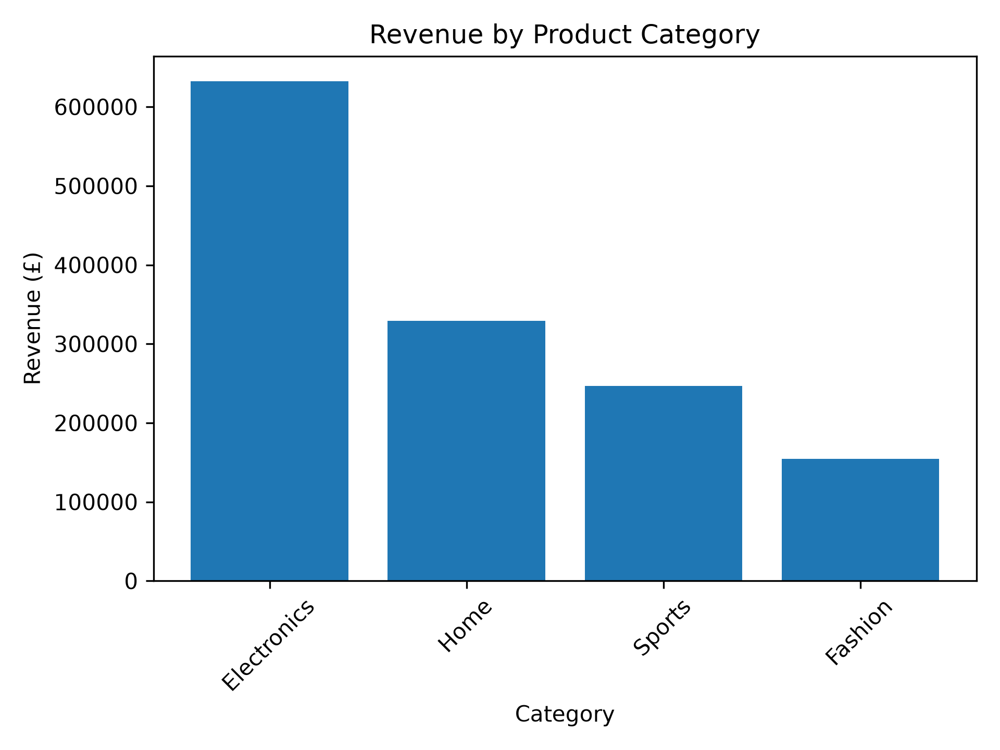
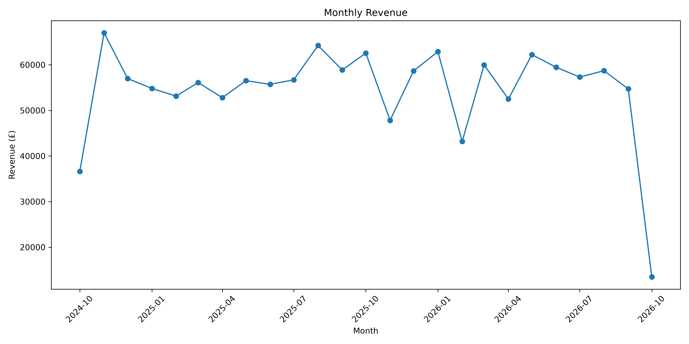
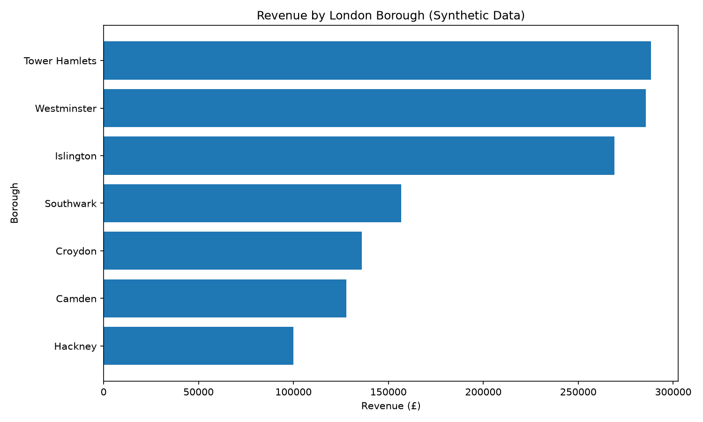
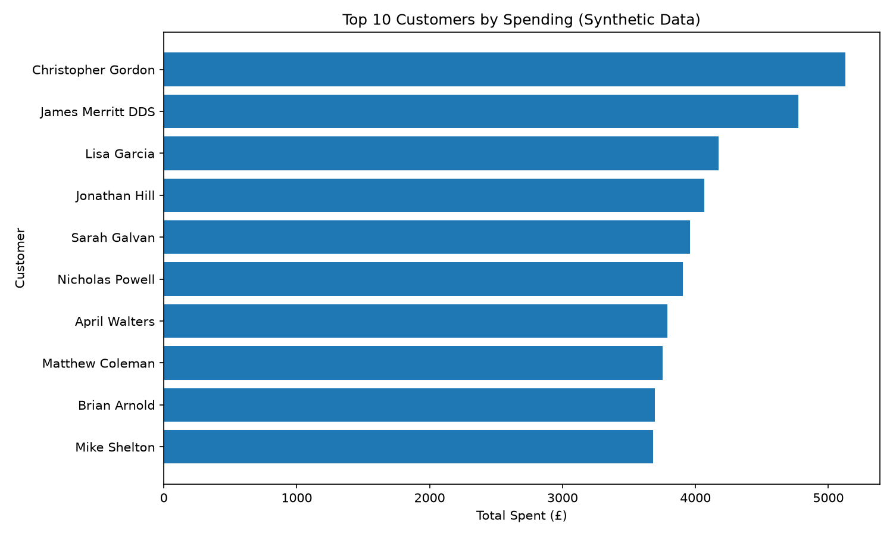
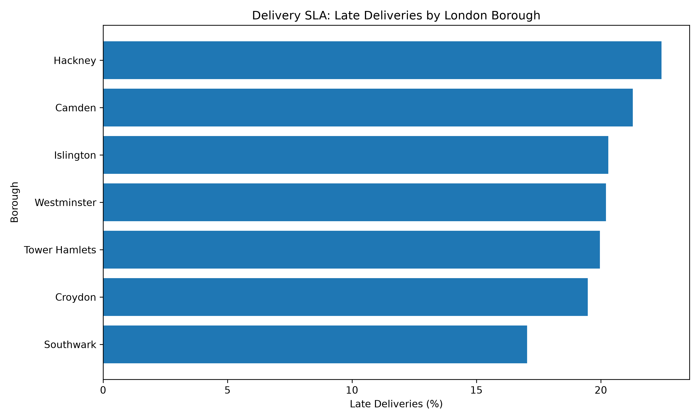

# London E-commerce Analytics

## Project Overview

This project analyses synthetic e-commerce data for a fictional London-based online retailer using Python, PostgreSQL, and SQL.

The goal is to explore sales performance, product revenue, customer purchasing behaviour, revenue distribution across London boroughs, and delivery performance.

All findings are based on synthetic data created for educational and portfolio purposes. They do not represent actual London retail or delivery performance.

## Tools & Technologies

* **Python** — data generation, data quality checks, and visualisation
* **Pandas** — data manipulation and analysis
* **Faker** — synthetic data generation
* **PostgreSQL** — relational database and SQL analysis
* **Matplotlib** — data visualisation
* **Git & GitHub** — version control and project documentation

## Dataset

The project contains five datasets or database tables:

* `customers` — customer details and approximate London boroughs
* `products` — product names, categories, and prices
* `orders` — order dates and order amounts
* `order_items` — products and quantities included in each order
* `deliveries` — promised delivery dates, actual delivery dates, boroughs, and delivery status

The core e-commerce dataset contains 1,000 customers, 10 products, 5,000 orders, and 10,000 order items. The delivery dataset contains 5,000 synthetic delivery records.

All data is synthetic and generated for educational and portfolio purposes. Borough and postcode-district mappings are approximate and should not be treated as official geographic data.

## Analysis

The SQL analysis explores:

* Revenue by product category
* Overall revenue, order volume, and average order value (AOV)
* Monthly revenue trends
* Top products by revenue
* Revenue by London borough
* Revenue per customer by borough
* Repeat customer behaviour
* Customer purchasing activity and top customers
* Delivery SLA by London borough
* Late delivery counts and late delivery percentages

## Key Findings

The analysis of the synthetic e-commerce dataset produced the following results:

* **Total revenue:** £1,363,145.14
* **Total orders:** 5,000
* **Average order value (AOV):** £272.63
* **Top revenue category:** Electronics
* **Highest-revenue product:** Smart Watch

### Delivery SLA

The synthetic delivery dataset contains 5,000 delivery records:

* **On-time deliveries:** 4,000 (80%)
* **Late deliveries:** 1,000 (20%)
* **Highest late delivery percentage:** Hackney (22.44%)
* **Lowest late delivery percentage:** Southwark (17.04%)

The difference between the highest and lowest late delivery percentages is 5.40 percentage points.

These figures illustrate how SQL can be used to monitor delivery performance and compare service levels across locations. They do not indicate actual delivery performance in London or establish the causes of delays.

## Visualisations

### Revenue by Product Category

### Monthly Revenue

### Revenue by London Borough

*Note: This chart uses synthetic data and does not represent actual London retail revenue.*

### Top 10 Customers by Spending

*Note: Customer names and spending figures are synthetic.*

### Delivery SLA by London Borough

This chart compares the percentage of late deliveries across seven boroughs using synthetic data.

