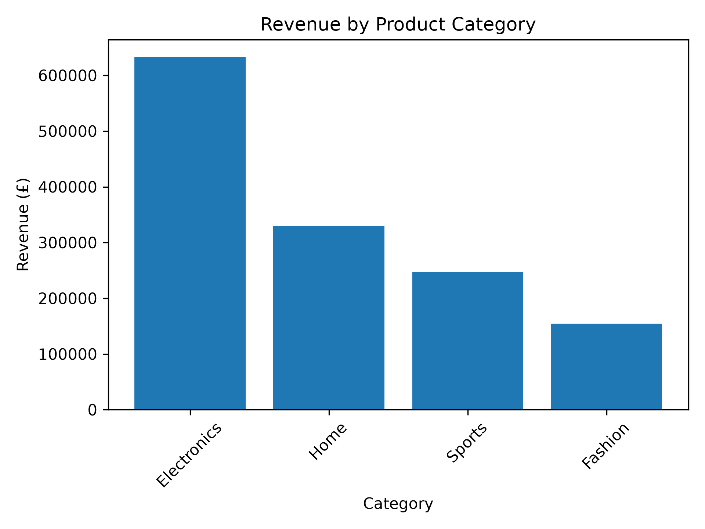
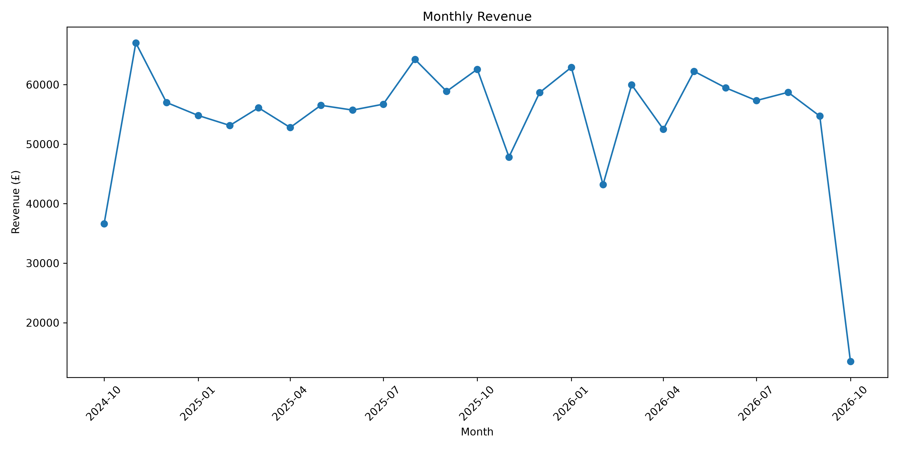
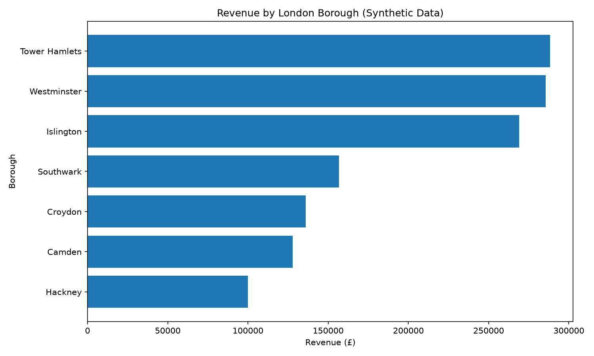

# London E-commerce Analytics

## Project Overview

This project analyses synthetic e-commerce data for a fictional London-based online retailer using Python, PostgreSQL, and SQL.

The goal is to explore sales performance, product revenue, customer purchasing behaviour, and revenue distribution across London boroughs.

## Tools & Technologies

* **Python** — data generation and data quality checks
* **Pandas** — data manipulation
* **Faker** — synthetic data generation
* **PostgreSQL** — relational database and SQL analysis
* **Git & GitHub** — version control and project documentation

## Dataset

The project contains four datasets:

* `customers` — customer details and approximate London boroughs
* `products` — product names, categories, and prices
* `orders` — order dates and order amounts
* `order_items` — products and quantities included in each order

All data is synthetic and generated for educational and portfolio purposes. Borough and postcode-district mappings are approximate and should not be treated as official geographic data.

## Analysis

The SQL analysis explores:

* Revenue by product category
* Overall revenue, order volume, and average order value
* Monthly revenue trends
* Top products by revenue
* Revenue by London borough
* Revenue per customer by borough
* Repeat customer behaviour

## Key Findings

The analysis of the synthetic dataset produced the following results:

* **Total revenue:** £1,363,145.14
* **Total orders:** 5,000
* **Average order value (AOV):** £272.63
* **Top revenue category:** Electronics
* **Highest-revenue product:** Smart Watch

All figures are based on synthetic data generated for this portfolio project and do not represent actual London retail performance.

## Project Status

The data generation, data quality checks, PostgreSQL setup, and initial SQL analysis are complete.

Further work will include improving the documentation, presenting key findings, and building a dashboard.

## Revenue by Product Category

## Monthly Revenue

## Revenue by London Borough

*Note: This chart uses synthetic data and does not represent actual London retail revenue.*

